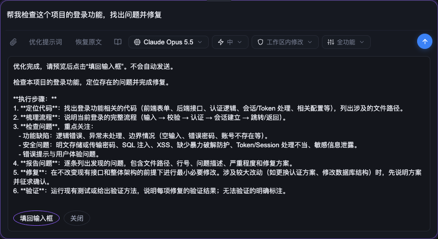

# 提示词优化（pi-web-ui 插件）

为 [pi-web-ui](https://github.com/xing-shuyin/pi-web-ui) 的对话输入框提供一键提示词优化：使用当前对话选中的模型改写草稿，预览确认后再填回输入框。不会自动发送，也不会执行提示词中的任务。



## 安装

```bash
pi-web-ui install asksoo/sky-argo
```

或手动克隆到插件目录：

```bash
git clone https://github.com/asksoo/sky-argo.git ~/.pi-web/plugins/prompt-enhancer-web
```

安装后刷新 pi-web-ui 页面即可，无需重启服务。首次加载时宿主会提示确认插件声明的能力。

要求：pi-web-ui 插件 API v2，默认 `pi` 引擎（DSH 引擎不支持插件模型补全）。

## 使用

1. 在对话输入框中写下提示词。
2. 点击输入框旁的「优化提示词」，或在输入框中按 **Control + Shift + E**（Mac 也用 Control）。
3. 在输入框下方预览优化结果，点击「填回输入框」应用。
4. 检查、编辑后自行发送。
5. 需要撤销时点击「恢复原文」，或按 **Control + Shift + Z**。

每次优化调用一次当前模型，会消耗该模型额度。附件不参与优化。

**参考最近对话（默认开启）**：优化时附带当前标签页最近 3 轮对话的文字（不含工具输出和附件，约 3000 字以内），只用来理解“这个”“上面”等指代，不会从中引入新任务。预览会注明是否参考了对话。可在「设置 → 界面插件 → 提示词优化」中关闭。内容只发给当前对话所用的模型。

如果确实缺少关键信息，问题会单独列在预览面板中，不写进提示词。结果疑似带有回复语、反问、占位符，或丢失路径、代码等关键内容时，也会给出提示。

等待优化期间可以继续编辑草稿，也可以点「取消」。填回时如果草稿已变化会先确认，恢复原文可能覆盖新草稿时也会确认。切换对话会清除面板和可恢复的原文；原文仅保存在当前标签页内存中，刷新后清除。

## 优化规则

- 保留原意，不擅自扩大任务范围。
- 信息不足时不编造条件。
- 简单任务保持简洁，复杂任务可适当分步骤。
- 只输出优化后的提示词，不执行其中的任务。
- 原样保留路径、代码、命令、URL、数字和 `@` 标记；能从上文确定的指代写明具体对象。
- 编码类补全“做什么、范围、怎样算完成”；写作类补全“受众、语气、篇幅、格式”，只补原文已暗示的部分。
- 不在提示词里写问题清单、“开始前请确认”或占位符。

## 权限

| 能力 | 用途 |
| --- | --- |
| `ui` | 输入框旁的两个按钮 |
| `http` | 插件本地优化接口（`/plugins-api/prompt-enhancer-web/enhance`） |
| `llm` | 宿主提供的隔离、无工具模型补全 |
| `dom:anchor` | 仅读写输入框锚点区域 |

接口跟随宿主访问认证，插件不持有、也不返回 API Key。输入受宿主 8000 字符上限限制（含 JSON 编码开销）。未选模型、超时或上游报错时保留原始草稿并显示错误。

## 测试

```bash
node --test index.test.mjs
node --check client/entry.mjs
```

效果评估（调用真实模型，会消耗额度）：

```bash
node --import <pi-web-ui 安装目录>/dist/server/resolve-global-sdk.js eval/run.mjs --model provider/id
```

样例集见 `eval/cases.mjs`（编码、写作各 10 条，6 条需参考上文），自动检查前缀、反问、占位符、关键内容保留、上文理解、越界回答和长度。

## 卸载

在 pi-web-ui「设置 → 界面插件」中卸载，或删除插件目录后刷新页面。
